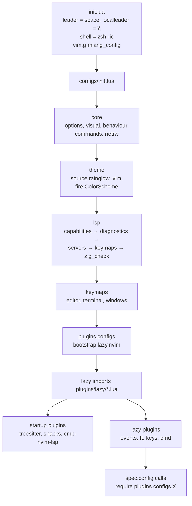
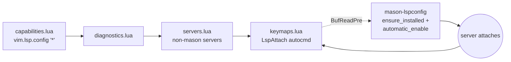
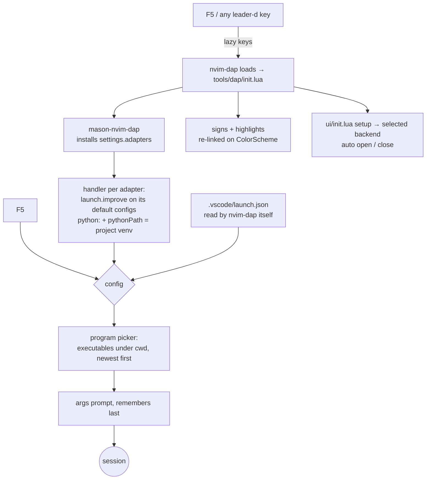

# Config overview

How this Neovim config is put together, where everything lives, and how to extend it.
Read this instead of re-exploring the repo.

> [!NOTE]
> **Keeping this file current.** Each subsystem has its own `##` section with the same shape
> (*What* / *Files* / *How it works* / *Extending* / *Gotchas*). When you add a subsystem, copy
> that shape. When you move or rename a file, search this doc for its old path.
> Requirements and install notes live in `README.md`; this doc only explains how things fit together.

## Contents

1. [Philosophy](#philosophy)
2. [Directory map](#directory-map)
3. [Startup and load order](#startup-and-load-order)
4. [Recipes: adding things](#recipes-adding-things)
5. [Keymaps](#keymaps)
6. Subsystems:
   [Core](#core) ·
   [Theme](#theme) ·
   [LSP](#lsp) ·
   [Zig extras](#zig-extras) ·
   [Completion and snippets](#completion-and-snippets) ·
   [Formatting](#formatting) ·
   [Treesitter and folding](#treesitter-and-folding) ·
   [UI](#ui) ·
   [snacks.nvim](#snacksnvim) ·
   [Markdown rendering](#markdown-rendering) ·
   [File explorers](#file-explorers) ·
   [Terminal](#terminal) ·
   [Debugging (DAP)](#debugging-dap) ·
   [Jupyter](#jupyter) ·
   [Utilities](#utilities)
7. [External tools](#external-tools)
8. [Tests and verification](#tests-and-verification)
9. [Known issues and planned work](#known-issues-and-planned-work)

---

## Philosophy

These rules shape the whole repo. New code should follow them.

| Rule | What it means in practice |
|---|---|
| **Nothing is auto-discovered** | Every module is loaded by an explicit `require`. A new file does nothing until something requires it. (An old globbing autoloader ran plugin configs before their plugins existed, so it was removed.) |
| **Specs and configs are separate** | `lua/plugins/lazy/*.lua` says **when** a plugin loads (lazy.nvim specs). `lua/plugins/configs/**` says **how** it is configured: each file returns a function that its spec's `config` calls. |
| **Strict load order** | `core → theme → lsp → keymaps → plugins`. A stage may depend on earlier ones, never on later ones. |
| **Comments explain *why*** | Comments record the reason and the trap (e.g. "capabilities MUST precede mason"), not what the line does. Keep that habit. |
| **No hardcoding** | Sizes come from content, values have one home, nothing is assumed about the environment (look up binaries with `exepath`, read `$TERMINAL`, …). Modules use each other's public API, not their internals. |
| **Fail soft** | Optional pieces are `pcall`ed or checked with `executable()`, so a missing tool degrades a feature instead of breaking startup. |
| **Theme-aware highlights** | Custom highlight groups are derived from the active theme and recomputed on `ColorScheme`, so `:ThemeSwitch` keeps them correct. |
| **Lazy by default** | Plugins load on events/filetypes/keys/commands. `lazy = false` only when something needs the plugin at startup, and the spec says why. |

Formatting style comes from `stylua.toml`: tabs, width 4, 120 columns, double quotes, always parenthesise calls.

---

## Directory map

```
init.lua                         leader keys, shell, mlang settings, then require("configs")
lua/
├── configs/                     everything that is NOT a plugin config
│   ├── init.lua                 the load order (core → theme → lsp → keymaps → plugins)
│   ├── core/                    plain options; must not require any plugin
│   │   ├── options.lua          responsiveness, search, editing, UI options
│   │   ├── visual.lua           numbers, splits, tab width
│   │   ├── behaviour.lua        persistent undo, empty-ShaDa-tmp cleanup
│   │   ├── commands.lua         :ThemeSwitch, :ThemeSwitchPermanent
│   │   └── netrw.lua            netrw settings + buffer-local netrw maps
│   ├── theme/
│   │   ├── init.lua             mode (dark/light), theme names, apply()
│   │   └── themes/rainglow/     vendored rainglow .vim colourschemes
│   ├── lsp/                     in dependency order (see LSP section)
│   │   ├── init.lua
│   │   ├── capabilities.lua     global client capabilities (cmp + ufo)
│   │   ├── diagnostics.lua      vim.diagnostic.config
│   │   ├── servers.lua          servers not handled by mason (angel_lsp)
│   │   ├── keymaps.lua          buffer-local maps on LspAttach, inlay hints
│   │   ├── zig_check.lua        compiler diagnostics for standalone .zig files
│   │   └── zls_sync.lua         finds a zls matching the installed zig
│   └── keymaps/                 non-plugin keymaps, one file per topic
│       ├── init.lua
│       ├── editor.lua           <C-l> <C-S> <C-a>
│       ├── terminal.lua         <C-X> <C-n> <C-h>n
│       └── windows.lua          <C-e>x <C-h>x <C-v>x, <space>t* (tabs)
├── plugins/
│   ├── lazy/                    lazy.nvim SPECS (imported as "plugins/lazy")
│   │   ├── general.lua          almost every plugin, grouped by section headers
│   │   └── trouble.lua          example of a per-topic spec file
│   └── configs/                 plugin CONFIGS, each returns function()
│       ├── init.lua             requires lazy.lua
│       ├── lazy.lua             lazy.nvim bootstrap + setup
│       ├── ui/                  lualine statuscol indent_blankline snacks
│       │                        snacks_image snacks_pickers ufo render_markdown which_key
│       ├── editor/              cmp luasnip conform lsp_signature
│       │   └── snippets/        LuaSnip definitions (global.lua, c.lua)
│       ├── lang/                mason mason_tools treesitter lazydev
│       └── tools/               jupynium, dap/
│           └── dap/             debugger (see Debugging section)
│               ├── init.lua     setup: adapters, signs, UI
│               ├── settings.lua the knobs: ui, adapters, terminal, picker, venv
│               ├── keymaps.lua  every debugger key (also the spec's lazy keys)
│               ├── launch.lua   program picker, args prompt, python venv
│               └── ui/          init.lua (front-end) + dap_ui, dap_view, widgets
└── utils/
    ├── keybinds.lua             map() wrapper used by most keymap files
    ├── terminal.lua             toggleable split terminal state machine
    └── log.lua                  file logger → stdpath("cache")/nvimdebug.log
after/
├── ftplugin/markdown.lua        soft wrap for prose
└── queries/markdown_inline/     extra conceals (link titles, escapes)
queries/html/images.scm          override of snacks.image's  query (see header)
scripts/zls_sync.py              downloads/verifies a zls matching `zig version`
test/markdown/                   rendering test document + assets
test/debug/                      debugger test programs, build.sh, headless run.lua
test/keymaps/run.lua             headless check: every mapping has an "Area: action" desc
SETUP.py                         checks system prerequisites mason cannot install
README.md                        requirements, plus "things to remember"
lazy-lock.json                   pinned plugin commits
package.json                     tree-sitter-cli (needed to build the latex parser)
```

---

## Startup and load order



Why the order matters:

- **Leader** is set in `init.lua` before any `<leader>` map exists or lazy reads a spec.
- **Theme before plugins**, so plugins that read highlight groups see the right colours.
- **LSP before plugins.** `capabilities.lua` calls `vim.lsp.config("*", { capabilities = … })`.
  mason-lspconfig (a plugin, loaded on `BufReadPre`) enables servers. If capabilities came later,
  servers would start without snippet and folding-range support.
  `cmp-nvim-lsp` is `lazy = false` only so that `capabilities.lua` can require it.
- **Plugins last.** From here lazy.nvim owns plugin configuration.

Plugins loaded at startup (`lazy = false`): `nvim-treesitter` (first buffer needs highlighting),
`snacks.nvim` (owns `vim.notify` and the picker), `cmp-nvim-lsp` (see above).
Everything else is lazy.

---

## Recipes: adding things

### A plugin

1. Add a spec to `lua/plugins/lazy/general.lua` under the right section header, or create a new
   `lua/plugins/lazy/<topic>.lua` returning a list of specs. Every file in that folder is imported.
2. If it needs more than `opts = {}`, create `lua/plugins/configs/<ui|editor|lang|tools>/<name>.lua`:

```lua
-- lua/plugins/configs/ui/foo.lua
return function()
	require("foo").setup({})
end
```

3. Call it from the spec:

```lua
{
	"author/foo.nvim",
	event = "VeryLazy", -- or ft / cmd / keys
	config = function()
		require("plugins.configs.ui.foo")()
	end,
},
```

4. Run `:Lazy sync`. `lazy-lock.json` changes; commit it.

### A keymap

- **Not plugin-related:** add it to the topic file in `lua/configs/keymaps/`, or create a new
  topic file and require it from `keymaps/init.lua`.
- **Plugin-related:** put it in that plugin's config file, after `setup()`.
- **LSP:** in the `LspAttach` callback in `lua/configs/lsp/keymaps.lua` (buffer-local).
- **Filetype-only:** in a `FileType` autocmd with `buffer = ev.buf` (see `core/netrw.lua`), or in
  `after/ftplugin/<ft>.lua` with `buffer = true`.
- If the plugin is lazy-loaded **by keys**, the key must also appear in the spec's `keys` list,
  or pressing it does nothing until something else loads the plugin.
- **Always give a `desc`** in the form `"Area: action"` (`"LSP: rename"`, `"Snacks: find files"`).
  which-key and the keymap picker show it, so it is the documentation. `test/keymaps/run.lua`
  fails on a map without one.
- Before picking a key, check the [prefix table](#keymaps), or search existing keys with `<C-t>k`.
- **New prefix?** Name it in the `spec` list in `plugins/configs/ui/which_key.lua` (the only place
  prefix names live) and add a row to the prefix table here.

Use `require("utils.keybinds").map(mode, lhs, rhs, opts)`. It defaults to `noremap` and accepts
function right-hand sides.

### An LSP server

- **Available in mason:** add its lspconfig name to `ensure_installed` in
  `lua/plugins/configs/lang/mason.lua`. `automatic_enable = true` starts it.
  For custom settings, add a `vim.lsp.config("<name>", { … })` call in the same file
  (see `asm_lsp`, `zls`).
- **Not in mason:** add `vim.lsp.config` + `vim.lsp.enable` in `lua/configs/lsp/servers.lua`
  (see `angel_lsp`), plus a `vim.filetype.add` if the filetype is new.
- Add the treesitter parser to `ensure_installed` in `lang/treesitter.lua`
  (`auto_install` also fetches missing parsers on open).

### A formatter

1. Add an entry in `formatters_by_ft` in `lua/plugins/configs/editor/conform.lua`, wrapped in
   `safe(...)` (runs every available formatter) or `safe_priority({...})` (first available group).
   Both skip formatters that aren't installed instead of erroring.
2. If mason has it, add it to `lua/plugins/configs/lang/mason_tools.lua`.
3. For a custom command, define `conform.formatters.<name>` (see `zigfmt`).

### A snippet

Add it to `lua/plugins/configs/editor/snippets/<ft>.lua` and require that file from
`snippets/init.lua`.

### Filetype settings

Create `after/ftplugin/<ft>.lua` and use `vim.opt_local`. It runs automatically for that filetype
(Neovim's runtime does this, not this config).

### A debugger for a language

Add the mason-nvim-dap adapter name to `adapters` in `plugins/configs/tools/dap/settings.lua`.
The adapter is installed on next use, and its default launch configurations get the program picker
and args prompt automatically. Add a test program to `test/debug/` and a row in
`test/debug/run.lua`'s `programs` list. See [Debugging](#debugging-dap).

### A user command

Put general ones in `lua/configs/core/commands.lua`. Plugin-specific ones go next to the
plugin's config.

---

## Keymaps

Leader is **Space**. Local leader is `\`.

### Looking keys up

| Key | Shows |
|---|---|
| `<C-t>k` | fuzzy search over **every** mapping *and every built-in key* (`dd`, `ciw`, `<C-w>v`, …, tagged `builtin`) by key or description. `<CR>` runs a mapping or opens the help for a built-in. `<A-g>` jumps to where a mapping is defined (or the help). `<A-b>` hides/shows built-ins |
| `<C-t>c` | fuzzy search over commands by name or description (your `desc`, a Vimscript command's definition, or for built-ins the summary from `:help ex-cmd-index`) |
| `<leader>?` | which-key popup of the current buffer's own maps (LSP, netrw, …) |
| pause on any prefix | which-key popup of what can follow (after 500 ms) |
| `:verbose map <key>` | where a key was last defined |

Both pickers are tweaked in `plugins/configs/ui/snacks_pickers.lua`. Keymap rows are
`mode key [tag] description` (plus the rhs when it's a string, not a Lua function), so the
description stays visible next to the preview. Built-in keys and Ex command summaries come from
Neovim's `doc/index.txt` (`:help index`), parsed once on first use (`help_index()`). A built-in
that a mapping changes (yours, a plugin's or a Neovim default like `Y`) is marked **(remapped)**.
The mapping's own row is in the same list. `:verbose map` shows the real file and line even for maps made
through `utils/keybinds.lua`, because its calls are tail calls (see [Utilities](#utilities)).

### Prefixes

Prefixes are reserved by topic. Their which-key names live in `plugins/configs/ui/which_key.lua`.

| Prefix | Owner | Defined in | Examples |
|---|---|---|---|
| `<C-t>` | Pickers (snacks) | `plugins/configs/ui/snacks.lua` | `f` files, `G` live grep, `g` grep buffers, `b` buffers, `h` help, `m` man, `k` keymaps, `c` commands |
| `<C-e>` | Explorers | `ui/snacks.lua`, `keymaps/windows.lua` | `e` snacks reveal, `E` snacks at cwd, `x` netrw |
| `<C-h>` | Horizontal | `keymaps/windows.lua`, `keymaps/terminal.lua` | `x` netrw hsplit, `n` horizontal terminal |
| `<C-v>` | Vertical | `keymaps/windows.lua` | `x` netrw vsplit |
| `<C-R>` | Markdown rendering | `ui/render_markdown.lua` | `m` toggle rendering, `l` live image preview, `w` wrap |
| `<leader>d` | Debugger | `tools/dap/keymaps.lua` | see [Debugging](#debugging-dap) for the full list |
| `<leader>t` | Tabs / toggles | `keymaps/windows.lua`, `lsp/keymaps.lua` | `tn` new tab, `tc` close, `th` inlay hints |
| `<leader>tt` | Trouble | `plugins/lazy/trouble.lua` | `ttx` diagnostics, `tts` symbols |
| `<leader>j` | Jupyter | `tools/jupynium.lua` | `ja` start/attach/sync, `jl1`–`jl9` load tab |
| `<leader>g` | Git | `ui/snacks.lua` | `gb` blame line |
| `t g` | LSP jump in new tab | `lsp/keymaps.lua` | `tgd` definition, `tgr` references |

Single keys and others:

| Key | Action | Defined in |
|---|---|---|
| `F5` `F9` `F10` `F11` `S-F11` | debug: continue, breakpoint, over, into, out | `tools/dap/keymaps.lua` |
| `<leader>?` | which-key: this buffer's keymaps | `ui/which_key.lua` |
| `<C-l>` | toggle search highlight | `keymaps/editor.lua` |
| `<C-S>` | save (normal and insert) | `keymaps/editor.lua` |
| `<C-a>{reg}` | run macro from register | `keymaps/editor.lua` |
| `<A-w>` / `<A-q>` | next / previous window (`<C-w>w` / `<C-w>W` in one chord; also from a terminal; a count jumps to window N) | `keymaps/windows.lua` |
| `<C-q>` | close window. If that would lose changes it asks: `<C-q>` again = close without saving, `y` = save and close, any other key = cancel. Replaces the built-in `<C-q>` = instant Visual block | `keymaps/windows.lua` |
| `<A-v>` | Visual block, instantly (bare `<C-v>` waits `timeoutlen` because `<C-v>x` exists) | `keymaps/editor.lua` |
| `<C-n>` | toggle vertical terminal | `keymaps/terminal.lua` |
| `<C-X>` | terminal → normal mode / `:x` in normal mode | `keymaps/terminal.lua` |
| `gd` / `gD` | LSP definition / declaration | `lsp/keymaps.lua` |
| `<leader>f` | LSP format | `lsp/keymaps.lua` |
| `]]` / `[[` | next/prev reference of word under cursor | `ui/snacks.lua` |
| `<leader>.` / `<leader>S` | scratch buffer / pick scratch | `ui/snacks.lua` |
| `<leader>lg` | lazygit | `ui/snacks.lua` |
| `zk` | peek fold, else LSP hover | `ui/ufo.lua` |
| `<leader>x` / `<leader>k` | Jupynium execute cell / kernel hover | `tools/jupynium.lua` |
| `<Tab>` / `<S-Tab>` | LuaSnip jump (only while a snippet is active) | `editor/luasnip.lua` |
| `<C-J>` / `<C-K>` / `<CR>` | cmp next / prev / confirm | `editor/cmp.lua` |

Nvim 0.11 built-in LSP maps (not redefined): `grn` rename, `gra` code action, `grr` references,
`gri` implementation, `K` hover, `<C-s>` (insert) signature help.

netrw buffer-local: `gh` hidden files, `gl` list style, `gb` banner, `q` close (each also with a
`<space>` prefix).

> [!WARNING]
> Ctrl-key prefixes shadow builtins: `<C-t>` tag-pop, `<C-h>` window left, `<C-v>` visual block,
> `<C-e>` scroll, `<C-R>` redo. Neovim waits `timeoutlen` (250 ms, `core/options.lua`) before
> running the bare builtin. Lower it if they feel slow. which-key's popup `delay` (500 ms, in its
> spec) only controls when the hint appears; it does not delay keys.

> [!NOTE]
> Some maps only exist after their plugin loads: `<C-R>*` after the first markdown file and
> Jupynium maps after the first Python file. Debugger keys always exist: they are lazy `keys`, so
> the first press loads nvim-dap.

---

## Core

**What:** editor options and behaviour that need no plugin.

**Files:** `lua/configs/core/*.lua`.

**How it works**
- `options.lua`: `updatetime 250` (drives CursorHold, LSP highlight, snacks.words),
  `timeoutlen 250`, smartcase search, `scrolloff 8`, `signcolumn=yes`, `confirm`,
  `splitkeep=screen`, `completeopt=menu,menuone,noselect`.
- `visual.lua`: relative numbers, cursorline (number only), splits open right/below,
  4-space indentation with `expandtab`.
- `behaviour.lua`: persistent undo in `~/.local/share/nvim/undo` (10 000 levels). On exit, deletes
  empty `*tmp*` ShaDa files that otherwise pile up.
- `commands.lua`: `:ThemeSwitch` (session only) and `:ThemeSwitchPermanent` (rewrites the
  `M.mode = …` line in `theme/init.lua`).
- `init.lua` (repo root) sets the shell to `zsh -ic`, so `:!` and `:terminal` get your aliases.

**Gotchas:** nothing in `core/` may `require` a plugin; it runs before lazy.nvim exists.

---

## Theme

**What:** rainglow colourschemes, vendored as `.vim` files.

**Files:** `lua/configs/theme/init.lua`, `lua/configs/theme/themes/rainglow/`.

**How it works**
- `M.mode`, `M.dark_theme` (`bold`) and `M.light_theme` (`bold-light`) are the settings.
- `M.apply(name)` sources the file and then fires `ColorScheme` manually. Sourcing doesn't fire it,
  and plugins rely on it to recompute their highlights.
- `M.apply_mode(mode)` also disables indent-blankline in light mode.

**Extending:** to change the theme, edit the names in `theme/init.lua`. Plugins that set their own
highlight groups should do it in a `ColorScheme` autocmd, deriving colours from existing groups
(see `ui/render_markdown.lua` for the blend pattern).

---

## LSP

**What:** language servers via Nvim 0.11's `vim.lsp.config` / `vim.lsp.enable`, installed by mason.

**Files:** `lua/configs/lsp/*`, `lua/plugins/configs/lang/mason.lua`.

**How it works**



- **Capabilities** (`capabilities.lua`): defaults + `foldingRange` (for ufo) + cmp's capabilities,
  applied to every server with `vim.lsp.config("*", …)`.
- **Diagnostics** (`diagnostics.lua`): `virtual_lines = true` (messages on their own line under the
  code), no virtual text, updates while typing.
- **Servers**: mason-lspconfig installs and enables everything in `ensure_installed`:
  lua_ls, pyright, clangd, jdtls, bashls, jsonls, yamlls, marksman, cmake, mesonlsp, ts_ls, html,
  cssls, eslint, dockerls, terraformls, asm_lsp, zls. Per-server overrides are in `mason.lua`.
  `angel_lsp` (AngelScript, built from source) is in `servers.lua`.
- **On attach** (`keymaps.lua`): enables inlay hints if the server supports them, and sets
  buffer-local maps. The `tg*` maps open the target in a new tab and use the client's own
  `offset_encoding` (mixing clangd and pyright on one buffer otherwise corrupts columns).
- `mason.lua` also notifies servers of saved files (`workspace/didChangeWatchedFiles`).
- `init.lua` defines `vim.g.mlang_config` (diagnostic filter settings for the MATLAB-style tooling).

**Gotchas**
- `K` is deliberately *not* mapped globally, so `keywordprg` still works in buffers without a server.
- Inlay hints are enabled client-side; zls removed its own option.

---

## Zig extras

**What:** two additions that make Zig work outside of `build.zig` projects and across Zig versions.

**Files:** `lua/configs/lsp/zig_check.lua`, `lua/configs/lsp/zls_sync.lua`, `scripts/zls_sync.py`.

**How it works**
- **zls_sync:** when zls is configured, runs `scripts/zls_sync.py` once per session with a
  Python 3 it finds on `PATH`. The script downloads a zls matching `zig version` from
  releases.zigtools.org, verifies its SHA-256 and caches it. It prints the path, which becomes
  zls's `cmd`. If anything fails, `cmd` is nil and lspconfig falls back to mason's zls.
- **zig_check:** for `.zig` files **not** under a `build.zig`, runs `zig build-exe`/`zig test`
  with `-fno-emit-bin` on read and save. It parses the errors and notes into diagnostics (including
  ones in imported files). It adds `-lc` when the file uses libc, cancels stale runs, and clears
  diagnostics on edit. Under a `build.zig`, zls's build-on-save handles it instead.

---

## Completion and snippets

**What:** nvim-cmp with LSP, LuaSnip, buffer and path sources; autopairs; lsp_signature.

**Files:** `plugins/configs/editor/{cmp,luasnip,lsp_signature}.lua`, `editor/snippets/`.

**How it works**
- All load on `InsertEnter`.
- cmp: `<CR>` confirms (selects the first item), `<C-J>`/`<C-K>` move through items or jump in a
  snippet. Sorting: score, recently used, locality.
- LuaSnip `<Tab>`/`<S-Tab>` only take over while a snippet is active, otherwise they pass through.
  An autocmd unlinks a snippet once you leave it, so `<Tab>` doesn't keep jumping back.
- lsp_signature shows a floating signature window (inline hints off).
- `typing-transformer.nvim` (your plugin) rewrites typed patterns, e.g. `cosnt ` → `const `.
  Rules are in its spec in `general.lua`.

---

## Formatting

**What:** conform.nvim, format on save.

**Files:** `plugins/configs/editor/conform.lua`, `plugins/configs/lang/mason_tools.lua`.

**How it works**
- `format_on_save` with a 500 ms timeout. Falls back to LSP formatting.
- `safe(names, opts)` runs every *installed* formatter in the list. `safe_priority(groups)` uses
  the first group that has any installed. Missing formatters are skipped silently.
- Current mapping: Lua → stylua, Python → ruff_format, else isort + black, C/C++ → clang-format,
  Go → goimports + gofmt, Rust → rustfmt, Zig → `zig fmt --stdin`, others → trim_whitespace.
- mason-tool-installer installs ruff, black, isort, stylua and clang-format.

**Gotchas:** codespell is deliberately not run on every save (slow, rewrites identifiers).

---

## Treesitter and folding

**Files:** `plugins/configs/lang/treesitter.lua`, `plugins/configs/ui/ufo.lua`.

**How it works**
- nvim-treesitter is pinned to the **`master` branch**. The config uses
  `nvim-treesitter.configs`, which `main` removed. Don't bump the branch without rewriting.
- `ensure_installed` + `auto_install`. `latex` is built from its grammar, so it needs
  `tree-sitter-cli` (`package.json`).
- Folding: nvim-ufo, provider chain **LSP → treesitter**. All folds start open (`foldlevel 99`).
  A `FileType` autocmd sets treesitter `foldexpr` for buffers ufo skips.
- `zk` peeks at a closed fold, or falls back to LSP hover.

---

## UI

**Files:** `plugins/configs/ui/{lualine,statuscol,indent_blankline,which_key}.lua`.

- **lualine:** global statusline, theme `auto` (follows the colourscheme), relative file path.
  Extensions: lazy, mason, nvim-dap-ui, quickfix.
- **statuscol:** custom status column with right-aligned relative numbers.
- **indent-blankline:** a gradient of 20 highlight groups from grey to red, so deep nesting shows.
  Disabled in light mode by `theme/init.lua`.
- **which-key** (`ui/which_key.lua`): shows what can follow a prefix after a 500 ms pause. Prefix
  names are registered there; key descriptions come from each map's `desc`. `<leader>?` shows the
  buffer-local maps.
- **lualine** also shows the debug session status (`dap.status()`) while a session runs.
- **Popups:** `vim.ui.select` and `vim.ui.input` are snacks' picker and input (installed on
  `UIEnter`). dressing.nvim was removed: it replaced both with its own plain list, which can't
  show highlighted entries.
- **trouble.nvim:** diagnostics, symbols and lists under `<leader>tt`.

---

## snacks.nvim

**What:** one plugin covering the picker, explorer, notifier, images, scratch buffers, lazygit and
word references.

**Files:** `plugins/configs/ui/snacks.lua` (+ `snacks_image.lua`).

**Enabled modules:** bigfile, explorer, picker, image, input, notifier (it replaces `vim.notify`),
quickfile, words. Disabled: dashboard, indent, scroll, statuscolumn.

**Extending:** a new picker is a `kb.map("n", "<C-t>?", function() snacks.picker.<source>() end, …)`
line in `snacks.lua`. `:lua Snacks.picker()` lists every source.

---

## Markdown rendering

**What:** rendered headings, tables and callouts in the buffer, plus inline images, LaTeX and Mermaid
via the kitty graphics protocol (Ghostty).

**Files:** `ui/render_markdown.lua`, `ui/snacks_image.lua`, `after/ftplugin/markdown.lua`,
`after/queries/markdown_inline/highlights.scm`, `queries/html/images.scm`, `test/markdown/`.

**How it works**
- render-markdown loads on `ft = markdown, quarto`. Its heading and code colours are blended from
  theme groups and recomputed on `ColorScheme`.
- snacks.image draws images and converts them with ImageMagick, Ghostscript, tectonic and mmdc.
  The source is concealed once drawn and reappears when the cursor is inside it.
- `snacks_image.lua` adds two toggles by wrapping **internal** snacks classes
  (`vim.g.markdown_images_off`, `vim.g.markdown_live_off`). Live preview draws the image below
  the source while you edit it. **If a snacks update breaks image toggling, look here first.**
- `queries/html/images.scm` fixes an upstream query: a void `` in markdown would otherwise
  swallow everything after it.
- Markdown buffers soft-wrap.

**Gotchas:** wide tables break under soft wrap (a render-markdown/Neovim limitation). Use `<C-R>w`.

---

## File explorers

- **snacks explorer** (primary): `<C-e>e` reveals the current file, `<C-e>E` opens at cwd.
  Sidebar layout, dotfiles shown, `.gitignore` respected, deletes go to the system trash.
  Inside it, `<C-h>` toggles hidden files and `<C-i>` toggles ignored files.
- **netrw** (kept for splits and `scp://`): `<C-e>x`, `<C-h>x`, `<C-v>x`. Tree view, no banner.
  Toggles are in `core/netrw.lua`. netrw's hide state is global, so `refresh()` redraws and puts
  the cursor back on the same entry by name.

---

## Terminal

**Files:** `utils/terminal.lua` (logic), `configs/keymaps/terminal.lua` (keys).

One reusable terminal per direction (`vertical` `<C-n>`, `horizontal` `<C-h>n`). Toggling hides
the window but keeps the buffer, so the shell and scrollback survive. A new terminal starts in the
current file's directory. `<C-X>` leaves terminal mode.

---

## Debugging (DAP)

**What:** nvim-dap with codelldb (C, C++, Rust, Zig) and debugpy (Python), installed by
mason-nvim-dap. A choice of UI, inline variable values (nvim-dap-virtual-text), and a statusline
indicator.

**Files:** spec in `plugins/lazy/general.lua` (DEBUGGING section), `plugins/configs/tools/dap/`:

| File | Role |
|---|---|
| `settings.lua` | **the knobs**: `ui`, `adapters`, `external_terminal`, `picker_skip_dirs`, `venv_dirs` |
| `init.lua` | setup: virtual text, mason-nvim-dap handlers, signs and highlights, UI setup |
| `keymaps.lua` | every debugger key, as a lazy `keys` list (the spec uses it directly) |
| `launch.lua` | `pick_program`, `ask_args`, `python_path`, `improve(config)` |
| `ui/init.lua` | UI front-end the keymaps call; dispatches to the selected backend |
| `ui/{dap_ui,dap_view,widgets}.lua` | one backend per UI |

**Terms**
- **Adapter:** the program that speaks the Debug Adapter Protocol for a language (codelldb,
  debugpy). mason installs it; mason-nvim-dap registers it with nvim-dap.
- **Launch configuration:** *how* to start a session (program, args, cwd). You pick one when you
  press `F5` without a running session.

**How it works**



- **No per-language config files.** mason-nvim-dap ships default launch configurations for every
  adapter. `launch.improve` swaps their blocking `vim.fn.input` prompts for a picker and
  `vim.ui.input`, so a newly added adapter gets the same behaviour.
- **Program picker** (`launch.pick_program`): lists executables under the cwd. It skips hidden
  directories and `picker_skip_dirs`, and keeps files with the user-execute bit that don't start
  with `#!` (scripts). The last pick comes first (while it's under the cwd), then newest builds.
  Folders end in `/` (highlighted as `Directory`) and programs in `*` (as `Function`), like
  `ls -F`. Two entries follow the list:
  - **Browse…** is a netrw-like popup. It shows `../`, subdirectories (hidden ones last) and the
    programs in that directory. Pick a directory to enter it, a program to choose it. It starts
    where the last pick was, else in the cwd. If the cwd has no executables, the browser opens
    directly.
  - **Type a path…** prompts with file completion.
- **With or without arguments:** every launch configuration comes in both forms, e.g.
  **LLDB: Launch** / **LLDB: Launch (args)**. `F5` asks which one. Adapters whose defaults have
  no arguments variant (debugpy) get an "(args)" copy from `launch.with_args_variants`. The args
  prompt uses shell-like quoting and remembers your last answer.
- **Python** runs the current file, with `pythonPath` = `$VIRTUAL_ENV` / `$CONDA_PREFIX`, else a
  `venv_dirs` directory found upwards from the file, else `python3`.
- **Only adapters listed in `settings.adapters` are registered.** An old mason install (e.g.
  `cpptools`) doesn't add a second set of configurations.
- **UIs** (`settings.ui`): all three are installed. Only the selected one is required, so the others
  never load.

| UI | Looks like | Notes |
|---|---|---|
| `"dap-ui"` (default) | panes left (scopes, watches, stack) + bottom (console, REPL) | opens/closes with the session |
| `"dap-view"` | one tabbed panel (scopes, watches, threads, breakpoints, exceptions, REPL) + console | `auto_toggle`; switch views with the winbar letters |
| `"widgets"` | nothing until asked: floats for scopes/stack, hover for eval, sidebar on `<leader>dU` | no plugin; no watches |

  A backend can leave an action out; `ui/init.lua` then falls back to the widgets implementation.
- **Closing:** dap-ui closes when the last session ends (`dap.listeners.on_session`), not on the
  `terminated`/`exited` events: codelldb answers `<leader>dq` with a bare disconnect, so those
  events don't always arrive. If the cursor was in a dap-ui window, it moves to a code window
  first. For every UI, `ui/init.lua` then closes leftover debugger floats (hover, scopes, stack)
  and the program's output terminal window (the buffer is kept).
- **Signs:** `●` breakpoint, `◆` conditional, `◉` logpoint, `○` rejected, `▶` stopped (the line is
  highlighted). Colours link to the theme's `Diagnostic*` groups and are re-linked on `ColorScheme`
  (rainglow runs `highlight clear`).

**Keys**

| Key | Action |
|---|---|
| `F5` / `<leader>dc` | start / continue |
| `F10` / `<leader>do` | step over |
| `F11` / `<leader>di` | step into |
| `S-F11` / `<leader>du` | step out |
| `F9` / `<leader>dt` | toggle breakpoint |
| `<leader>dB` | conditional breakpoint (prompts for the condition) |
| `<leader>dL` | logpoint (message, `{expr}` interpolates) |
| `<leader>db` / `<leader>dx` | list / clear all breakpoints |
| `<leader>dE` | exception breakpoints (the adapter offers the choices) |
| `<leader>dC` | run to cursor |
| `<leader>dp` / `<leader>dR` / `<leader>dq` | pause / restart / terminate |
| `<leader>dl` | run last configuration again |
| `<leader>de` | evaluate word or visual selection |
| `<leader>dw` | watch word or visual selection |
| `<leader>ds` / `<leader>df` | variables in scope / call stack |
| `<leader>dU` / `<leader>dr` | toggle UI / toggle REPL |

**Extending**
- New language: see [the recipe](#a-debugger-for-a-language).
- Project-specific launch settings (env vars, build dirs, attach to a process): put them in the
  project's `.vscode/launch.json`, not in this config.
- New UI: add `ui/<name>.lua` implementing any of `setup/toggle/eval/watch/frames/scopes`, register
  it in `backends` in `ui/init.lua`, add its lazy spec (`lazy = true`), and run the test with
  `DAP_TEST_UI=<name>`.

**Gotchas**
- After mason installs an adapter for the first time, restart Neovim if launching it fails: the
  adapter path is resolved when mason-nvim-dap first loads.
- Breakpoints don't persist across restarts.
- The program picker lists executables under the **cwd**, so start Neovim in the project root.
- dap-view's panel sets `winfixbuf`: `:edit` inside it fails. Jump back to a code window first.

**Test:** `test/debug/` (see its README). `build.sh`, then
`nvim --headless -c "luafile test/debug/run.lua"` runs a real session in every language.

---

## Jupyter

**What:** jupynium.nvim drives a Jupyter notebook in Firefox from a `.ju.py` file.

**Files:** `plugins/configs/tools/jupynium.lua`. Usage notes are in `README.md` ("Things to remember").

Loads on Python files or its commands. Cells are separated by `# %%`. `<space>ja` starts, attaches
and syncs in one go. `<space>x` executes the current cell.

---

## Utilities

| Module | API | Notes |
|---|---|---|
| `utils.keybinds` | `map(mode, lhs, rhs, opts)` | `noremap` by default; uses `vim.keymap.set` for function RHS or multiple modes. Its calls are **tail calls** so Neovim records the caller's file/line as the map's origin, keep them that way |
| `utils.terminal` | `toggle("vertical" \| "horizontal")` | see [Terminal](#terminal) |
| `utils.log` | `log.write(...)` / `log:write(...)` | appends `vim.inspect`ed values plus the caller's file to `stdpath("cache")/nvimdebug.log` |

---

## External tools

Full list with install hints: `README.md`. `python3 SETUP.py` checks which are present.

| Tool | Needed for |
|---|---|
| git, node/npm, tree-sitter-cli | lazy.nvim, several LSPs, building the `latex` parser |
| gcc/clang, python3, JDK 17+, go, rust, zig | language servers, formatters, debuggers |
| (none extra) | debuggers: codelldb and debugpy come from mason |
| magick, gs, tectonic, mmdc | markdown images, PDF, LaTeX, Mermaid |
| lazygit | `<leader>lg` |
| Ghostty (or kitty) | graphics protocol for inline images |

---

## Tests and verification

| Test | Run | Checks |
|---|---|---|
| Markdown rendering | open `test/markdown/markdown_view_test.md` | every rendering feature, by eye (assets include spaces in paths, wide images) |
| Debugger | `test/debug/build.sh`, then `nvim --headless -c "luafile test/debug/run.lua"` | config loads, adapters registered, keys mapped, real session per language stops on the `BREAK` line, UI actions work. `DAP_TEST_UI=…`, `DAP_TEST_ONLY=…` |
| Keymaps | `nvim --headless --cmd "set verbose=1" -c "luafile test/keymaps/run.lua"` | every global map and lazy key from this config has an `"Area: action"` desc; built-in keys parse for every mode and `<CR>` on one opens its help |

Both headless tests exit non-zero on failure. Smoke check that any lazy plugin's config runs:

```sh
nvim --headless -c 'lua require("lazy").load({ plugins = { "<name>" } })' -c 'qa!'
```

`:checkhealth`, `:Lazy`, `:Mason`, `:LspInfo`, `:ConformInfo` are the usual status pages.

---

## Known issues and planned work

- [x] Keybind lookup: which-key groups, `<C-t>k` keymap picker, `<leader>?`, `Area: action`
  descriptions, `test/keymaps/run.lua`.
- [x] Debugging: fixed the broken require paths; codelldb + debugpy; program picker; venv
  detection; UI choice; F-keys + `<leader>d` set; theme-aware signs; lualine status;
  `test/debug/`.
- [x] Cleanup: `STRUCTURE.md` folded into this file, stale paths in comments fixed, unused
  `cpptools` and dressing.nvim removed.
- [ ] Optional: persistent breakpoints across restarts; build before launch (e.g. `zig build`).
- [ ] `test/keymaps/run.lua` doesn't cover buffer-local maps (LSP, netrw).
